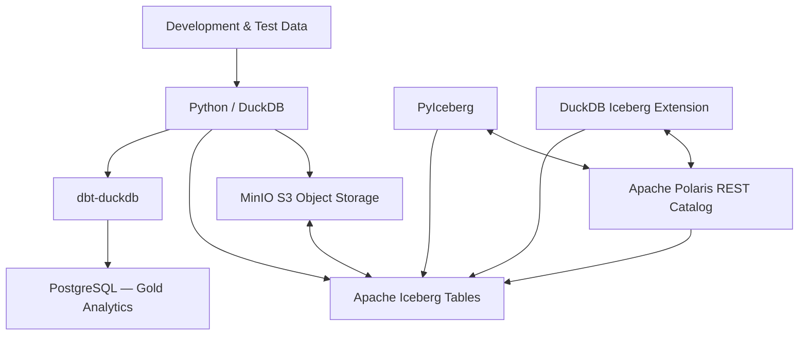

# Data Platform

**An open-source, locally hosted data engineering and analytics platform built to explore modern lakehouse architecture, data integration, transformation, governance, and machine learning.**

**Project Status:** Active Development  
**Started:** October 2026  
**Environment:** WSL / Ubuntu | Python 3.12 | Docker (select services)

## Overview

Data Platform is a personal engineering project focused on designing and implementing an end-to-end data ecosystem using open-source technologies.

The goal is to move beyond isolated scripts and static datasets toward a modular platform that supports the complete data lifecycle: ingestion, storage, transformation, data quality, modeling, analytics, and eventually machine learning.

The project follows a **medallion architecture (Bronze, Silver, Gold)** and incorporates elements of modern data lakehouse design, including S3-compatible object storage, Apache Iceberg tables, catalog management, analytical processing, and relational data publishing.

Development is incremental, with each integration tested and validated before introducing additional complexity.

## Project Objectives

- Build a modular, reproducible data engineering environment.
- Practice batch, full-refresh, and incremental ingestion patterns.
- Implement Bronze, Silver, and Gold data processing layers.
- Explore Apache Iceberg and open table formats.
- Develop transformation workflows using SQL, Python, DuckDB, and dbt.
- Implement dimensional data modeling and analytical data marts.
- Establish data quality, metadata, lineage, and governance practices.
- Introduce workflow orchestration and automated testing.
- Support downstream business intelligence and machine learning.
- Develop practical experience with data architecture and engineering design decisions.

## Architecture

The platform separates storage, processing, catalog management, and analytical consumption.

### Current Foundation



*Conceptual architecture illustrating the validated foundation and existing analytical tooling. Not every depicted component is part of a single automated pipeline.*

### Architectural Layers

| Layer | Technologies | Responsibility |
|---|---|---|
| Development | Python, uv, VS Code, Git | Application development and dependency management |
| Object Storage | MinIO S3 | Lakehouse storage |
| Table Format | Apache Iceberg | Open analytical table format |
| Catalog | Apache Polaris | Iceberg catalog and table metadata management |
| Processing | DuckDB, Polars, PyArrow | Data processing and analytical operations |
| Transformation | dbt-duckdb | SQL-based transformations and testing |
| Relational Analytics | PostgreSQL | Gold-layer relational data and analytical publishing |
| Infrastructure | WSL, Docker Compose | Local service hosting and configuration |
| Code Quality | Ruff, Pyright, Pytest | Linting, type checking, and automated testing |

## Implementation Status

### Completed and Validated

**Development Environment**
- [x] WSL Ubuntu development environment
- [x] Python environment and dependency management with uv
- [x] Git repository and source control
- [x] Ruff, Pyright, and Pytest validation

**Storage and Databases**
- [x] MinIO S3 installation and configuration
- [x] PostgreSQL installation and database configuration
- [x] DuckDB integration with S3-compatible storage
- [x] dbt-duckdb installation and initial model execution

**Apache Iceberg and Polaris**
- [x] Apache Polaris 1.8.0 deployed using Docker Compose
- [x] PostgreSQL-backed Polaris metadata persistence
- [x] Polaris authentication and REST catalog connectivity
- [x] Iceberg warehouse configured with MinIO
- [x] Bronze, Silver, and Gold catalog namespaces
- [x] Iceberg test table creation and data validation
- [x] PyIceberg integration testing
- [x] DuckDB Iceberg catalog connectivity and read testing

**Data Publishing and Testing**
- [x] Initial DuckDB-to-PostgreSQL full-refresh publishing implementation
- [x] PostgreSQL transaction rollback test
- [x] Static type checking and linting validation

These milestones demonstrate a functioning foundation, rather than a completed end-to-end production pipeline.

## Repository Structure

```text
data-platform/
├── dbt/                 # dbt project and SQL transformations
├── docs/                # Architecture and project documentation
├── infra/
│   ├── compose.yaml     # Polaris service configuration
│   ├── minio/           # MinIO access policy configuration
│   └── polaris/         # Polaris catalog configuration
├── scripts/
│   ├── test_polaris_connection.py
│   ├── test_iceberg_table.py
│   └── test_duckdb_iceberg.py
├── src/
│   └── data_platform/
│       └── publishing/  # Data publishing implementation
├── tests/               # Automated tests
├── pyproject.toml       # Python project configuration
├── uv.lock              # Locked Python dependencies
└── README.md
```

*This structure highlights the principal project components and is not an exhaustive file inventory.*

## Integration Validation

The following integrations have been tested successfully in the local development environment.

| Integration | Validation |
|---|---|
| DuckDB → MinIO | S3 object access |
| DuckDB → dbt | Model execution and tests |
| PyIceberg → Polaris | REST catalog connectivity |
| Polaris → PostgreSQL | Persistent catalog metadata |
| Polaris → MinIO | Iceberg warehouse configuration |
| PyIceberg → Iceberg | Test table creation and record verification |
| DuckDB → Polaris / Iceberg | Catalog attachment and record queries |
| PostgreSQL Publishing | Transaction rollback test |

### Development Quality Checks

```bash
pyright
uv run ruff check . --ignore SIM117
uv run pytest -q
```

The `SIM117` exclusion is temporary and tracks an identified code-cleanup item.

## Development Roadmap

### Phase 1 — Platform Foundation

**Status: Core integrations completed; hardening in progress**

- [x] Establish Python development environment
- [x] Configure object storage and analytical databases
- [x] Configure dbt and DuckDB
- [x] Deploy Apache Polaris
- [x] Integrate Apache Iceberg with MinIO
- [x] Validate PyIceberg and DuckDB interoperability
- [ ] Complete integration hardening
- [ ] Improve configuration portability and operational checks
- [ ] Expand automated integration testing

### Phase 2 — Data Ingestion and Processing

**Status: Planned**

- [ ] Identify and integrate public data APIs
- [ ] Implement full-load ingestion patterns
- [ ] Implement incremental ingestion and watermark tracking
- [ ] Introduce change data capture concepts
- [ ] Handle schema evolution and data deduplication
- [ ] Implement retry, idempotency, and recovery strategies
- [ ] Develop reusable ingestion components

### Phase 3 — Transformation and Data Modeling

**Status: Planned, with initial dbt capabilities validated**

- [ ] Develop Bronze-to-Silver transformations
- [ ] Implement standardized data quality checks
- [ ] Create dimensional models using star schemas
- [ ] Explore snowflake schemas and normalized models
- [ ] Build fact and dimension tables
- [ ] Implement slowly changing dimensions
- [ ] Publish governed Gold-layer analytical datasets

### Phase 4 — Orchestration and Governance

**Status: Planned**

- [ ] Evaluate and integrate a workflow orchestrator
- [ ] Automate ingestion and transformation workflows
- [ ] Introduce scheduling, monitoring, and alerting
- [ ] Evaluate OpenMetadata integration
- [ ] Establish metadata and lineage tracking
- [ ] Expand automated data validation

### Phase 5 — Analytics and Machine Learning

**Status: Planned**

- [ ] Introduce business intelligence dashboards
- [ ] Evaluate Metabase for analytical consumption
- [ ] Develop exploratory analysis workflows
- [ ] Engineer reusable analytical and predictive features
- [ ] Experiment with machine learning models
- [ ] Explore AI-enabled analytical use cases

### Future Enhancements

Additional tools and capabilities under consideration include Apache Spark, GitHub Actions, DBeaver, Terraform, Prometheus, Grafana, and semantic-layer technologies.

These are potential enhancements, not committed implementation requirements.

## Engineering Principles

The project follows several guiding principles.

**Incremental development:** Establish and validate each foundational component before expanding the architecture.

**Separation of concerns:** Keep storage, processing, metadata management, and analytical serving responsibilities distinct.

**Open technologies:** Favor interoperable tools and open standards to reduce unnecessary platform dependencies.

**Reproducibility:** Maintain configuration, dependencies, infrastructure definitions, and tests under version control wherever appropriate.

**Data reliability:** Prioritize validation, transaction safety, data quality, and recoverability.

**Practical learning:** Use realistic engineering scenarios to evaluate architectural tradeoffs, rather than introducing tools solely to increase stack complexity.

## Security and Configuration

The project is intended for local development and experimentation.

Sensitive configuration, including environment files, credentials, and private keys, is excluded from version control.

Infrastructure configuration uses environment-variable references where appropriate. Deployment to shared or production environments would require additional security, operational, and access-control hardening.

## Current Focus

The immediate priority is **integration hardening** of the Polaris–Iceberg–MinIO–DuckDB foundation.

Once this foundation is stable, development will shift toward external data ingestion, reusable load patterns, data quality, and dimensional modeling.

The long-term objective is a cohesive platform capable of supporting analytical reporting, data products, and future machine learning workloads.

---

**Maintained as an ongoing personal data engineering and architecture project.**